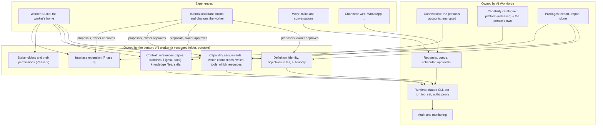
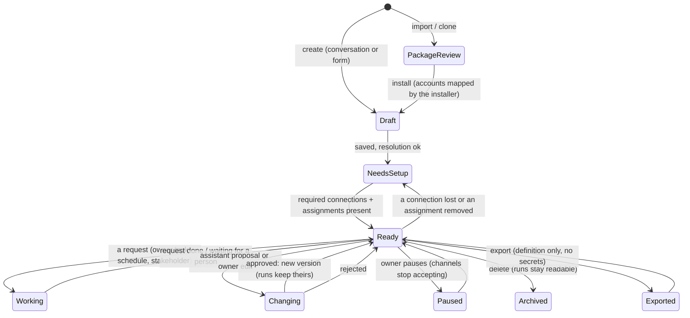
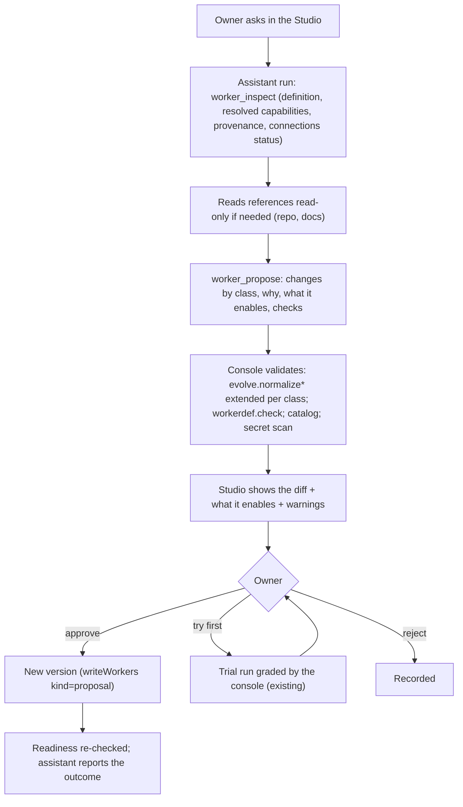
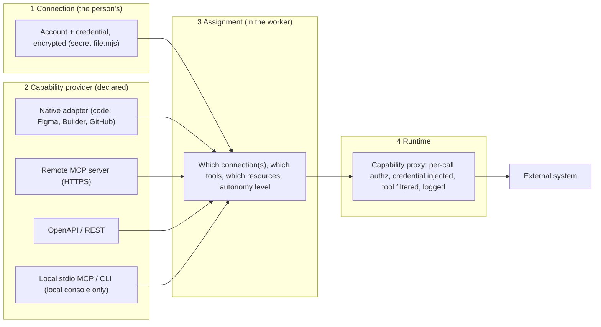
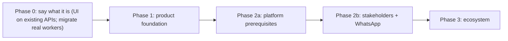

# AI Workforce: product direction and architecture assessment (2026-11-07)

**Status:** a proposal for discussion. Nothing in it is built or agreed. It answers the brief "AI Workforce — Product Vision, Architecture & Experience Direction" (deliverables A–J), grounded in the code at `c179bb6`.

**Method:** the code was read directly: `worker-ui/server.mjs`, `workspace.html`, `workerdef.mjs`, `catalog.mjs`, `integrations.mjs`, `integrations/*`, `workerpack.mjs`, `evolve.mjs`, `gateway.mjs`, `users.mjs`, `mcp/*`, and the owner's own data files (read only). Test claims come from the result files recorded in `bench/` (dates given). No suite was re-run for this document. Where the code and the docs disagree, the code was used.

---

## 0. The short version

**Can the product evolve into the vision?** Yes. The *platform* layer is close to what the vision calls "what AI Workforce owns": per-run computed tool sets, fail-closed authorisation, per-call checks, versioned manifests, portable packages without secrets, approved self-change, uid isolation, own provider keys. The *product* layer is the problem. It is organised around **conversations in workspaces**, with the worker as a dropdown and a form. The vision needs it organised around **the worker as a place the person owns**.

**What is genuinely missing** (not just renamed):
1. **Openness.** Every capability is a code entry in `server.mjs` (`CAPABILITIES`, `MCP_SERVERS`, `RESOURCES`). A person can't bring an MCP server, an API, a script or a database. Of the 24 catalogue entries, 7 are real connectors and 17 (WhatsApp, Slack, Shopify, Sheets…) are "recognised, no connector". Only Figma, Builder and Git Sync add tools of their own; `code` and `files` are bundles of core tools. GitHub sits outside the manifest system altogether.
2. **An owner-facing assistant.** Self-change exists (`evolve.mjs`), but only as a side effect of a task conversation, and only for five text fields.
3. **Worker-owned context.** Knowledge is one 20,000-character text field. There are no skills, no per-worker documents and no per-worker references. Files and repositories come from the workspace chosen *per task*, not from the worker.
4. **Anyone but the owner.** There's no stakeholder, no channel, no inbound request, no queue (one live run per person: `server.mjs` `active()`), no scheduler and no outbound notification.
5. **Worker-specific interfaces.** The one that exists (Git Sync) was built by the platform team, inside the main page: about 850 lines of `workspace.html`, plus `gitflow.mjs` (685 lines) and its routes. That is exactly the pattern the vision rejects, and it shows what an extension contract has to cover.

**Three facts that change the plan:**
- **The owner's three real workers are still schema 1** (`worker-ui/workers.json`: Senior UI/UX Design Engineer v5, Builder Page Engineer v9, BAU branch sync worker v1). The integration architecture, packages format 2 and upgrades don't yet apply to the workers actually in use. Migrating them is step zero.
- **The flagship WhatsApp scenario can't run on the hosted platform today.** "Prepare a design draft in Figma" needs `figma.plugin.edit`, which is desktop-only (`HOSTED_OFF`). Figma's REST API can't create nodes (`docs/figma-autonomy.md`). The MATW file is also view-only. A stakeholder-facing worker has to be always on (hosted), so this scenario needs a decision (§K2) before Phase 2.
- **Phase 2 has platform prerequisites** that the brief doesn't name: a public, always-on deployment (the pilot is reached through an SSH tunnel today), more than one run at a time per person, background jobs, and outbound messages.

**Recommended sequence** (§I): a short **Phase 0** first (migrate the real workers; re-centre the UI on the worker using existing APIs), then the brief's three phases. Two changes to them: Phase 2 starts with its platform prerequisites, and "bring your own capability" is split into a safe part early (remote MCP/OpenAPI through the existing per-call check) and a sandboxed part later (user code on the hosted platform).

**Decisions needed from the owner:** §K, seven items.

---

## A. Current product reality

### A.1 What a new user experiences today

**Local console** (`node worker-ui/server.mjs`, port 8799):
1. The page opens on the General worker in the "Executor" workspace, which is this repository itself. The sidebar shows, in order:
   - Workers & teams;
   - Workspace (Workspaces, Conversations, Changes & versions, Files);
   - Prompts (Favourites);
   - Integrations (Figma, Builder.io, GitHub);
   - a footer, "Local services", with switches for the Console and the Figma bridge (`workspace.html:1048–1127`).
2. With no workers defined, the canvas shows "Getting started: Give a specialist a real task" (`gettingStarted`, `workspace.html:4398`). It explains three concepts (Worker, Workspace with Inspect/Work, Team: `CONCEPTS`, line 2324) and asks "What would you like your AI worker to do?", with seven example chips (Shopify, Sheets, WordPress, Next.js, Builder.io, research, Git branches).
3. "Continue" opens a three-step composer (`openCreate`, line 2342):
   - **Describe:** free text.
   - **Tools and systems:** detected by regex (`integrations.mjs`, the manifests' `detect` patterns), each with its questions. Integrations with no connector are said plainly.
   - **Review and create:** name, first workspace, the pinned integrations, core capabilities, what it can do in that workspace, connection checks, what isn't possible, steps, knowledge and limits.
4. The worker is created (`POST /workers/from-request`) and becomes the composer's selection. The canvas shows a "Before you start" readiness box, capability chips and starter tasks.
5. A task starts a run, a headless `claude` process, in **the workspace selected in the composer**, not one that belongs to the worker. The person sees the conversation, an Activity panel, deliverables, and a per-message result.
6. To change the worker, the person opens **Edit worker**, a single form (`openWorkerEditor`, line 1901):
   - name, specialization and mission;
   - integrations with their settings;
   - core capabilities;
   - repositories;
   - "How it works", "What it knows" and "Hard limits";
   - what its integrations tell it;
   - other requirements, and when something is missing;
   - learnings and proposals;
   - Clone, Export and Delete.

**Hosted pilot** (`gateway.mjs`): an invite-only account (`users.mjs`; an operator creates it on the server). The person signs in and gets their own console as their own uid. They must connect their own Anthropic API key through `PUT /account/provider`, which has no settings page yet. After that, the same page as above, minus shell, the Figma plugin and Figma desktop MCP (`HOSTED_OFF`, `server.mjs:80`).

### A.2 Where the product fails to communicate its purpose
- **It explains the machinery before the outcome.** The first concepts a person meets are Workspace, Inspect/Work and Team. These are security and organisation mechanics. "A worker you own, that knows your project and does real work in your systems" isn't said anywhere.
- **The worker isn't a place.** It has no page of its own. It's a composer dropdown (`wkPick`) plus an edit form. Conversations, files, versions and the workspace all belong to the *workspace*. Nothing shows "this is your Frontend Engineer: what it knows, what it can reach, what it has done, how it's changing".
- **Platform plumbing sits at the same level as the person's work:** "Local services" switches, Changes & versions, Files, the "Executor" workspace (this repo), "Review older workers".
- **The worker's context is opaque.** A run's context is assembled from seven sources (`workerContext`, `server.mjs:1124`): platform rules, workspace, Team, the worker's own text, integration instructions, learnings, and the evolve instructions. The person can see the composed result only in a run snapshot file (`runs/<id>.worker.md`), not in the product.
- **Creation is a form with a description box in front of it.** Detection is pattern matching. It's honest and deterministic (a decision that was right), but it can't "understand the project". It knows only what the description names.
- **Hosted setup is operator- and API-driven:** an account created on the server, the provider key connected with a PUT request, and GitHub/Figma/Builder each on their own page.

### A.3 The most significant limitations

| # | Limitation | Where | Why it matters for the vision |
|---|---|---|---|
| 1 | Capabilities, tool servers and account checks are code | `server.mjs:188` `CAPABILITIES`, `:215` `MCP_SERVERS`, `:559` `RESOURCES`; `catalog.check()` refuses a manifest naming a capability the code lacks | "Native integrations are not the boundary" is false today: every new capability is a platform release |
| 2 | One live run per person | `server.mjs:2503`; `HOSTED_ARCHITECTURE.md` §6 | Stakeholder requests, scheduled work and several workers can't run alongside the owner |
| 3 | The worker doesn't own its context | `normalizeWorker` (`server.mjs:732`): `knowledge` ≤ 20,000 chars of text; references and uploads exist only on Teams | "Project context, knowledge, skills" must belong to the worker and travel with it |
| 4 | Self-change is text-only and task-embedded | `evolve.mjs:15` `FIELDS` = workflow, knowledge, limitations, onMissing, outcomes; offered in every task run (`launchPlan`, `server.mjs:325`) | The internal assistant needs its own mode, a wider vocabulary and approval classes |
| 5 | Connections are mostly one per integration | GitHub: one token (`github.mjs`); Figma: one credential file shared by every worker with `figma.read`; **Builder is the exception** (several spaces, per-worker read/write, production read-only) | "Connection ≠ capability; explicit assignment" exists only for Builder |
| 6 | No stakeholders, channels, scheduling or notifications | nothing in `server.mjs` or `gateway.mjs`; `whatsapp@1.0.0` is `recognised` with no connector | All of Part 8 |
| 7 | Worker-specific UI lives in the platform page | Git Sync UI ≈ `workspace.html:2720–3570`, `gitflow.mjs`, routes at `server.mjs:3214–3309` | Part 6: interfaces must be user-owned and outside the main repo |
| 8 | Real workers on the old schema | `workers.json` (3 × schema 1) | The new model isn't exercised by real use |
| 9 | Single host, file storage, no metrics | `HOSTED_ARCHITECTURE.md` §9; JSON files per data dir; `/healthz`, `/readyz` only | Fine for a pilot; organisational use needs monitoring and alerting |
| 10 | No organisation model | `users.mjs`: id, email, name, uid; no org, roles or shared Teams | Admins, stakeholders and shared workers come later, but the identity model must allow them |

### A.4 What is strong, and must be preserved
- **Effective access = worker ∩ workspace mode ∩ Team scope ∩ platform**, computed per run and enforced below the model (`workerRuntime`, `server.mjs:277`): tool lists, deny rules, `--restricted`, adapter profiles, and the file guard hook.
- **Fail-closed authorisation with per-call rechecks and live connections** (`mcp/authz.mjs`, `/authz/:runId`, `refreshLive`). Recorded: authz 8/8, live 11/11, runtime-tools 3/3.
- **Versioned, immutable, reviewed manifests** (`catalog.mjs`, `releases.lock.json`), worker schema 2 with pinned integrations (`workerdef.mjs`), upgrade diffs, and migration with undo.
- **Packages:** ZIP with an allowlist, checksums, no credentials, no memory, paths redacted, secret-looking text stops the export, and the installing console decides access again (`workerpack.mjs`). Recorded 19/19 (2026-11-04).
- **Approved self-change:** proposal → validation → optional trial run graded by the console from evidence, not the worker's words → person approves → new recorded version, restorable (`evolve.mjs`). Recorded: evolve 18/18; builder-evolution 10/11, where the failing step is the honesty check, which caught a proposal claiming abilities it lacked.
- **Run snapshots and version pinning:** every run records the exact definition, Team and context it started with.
- **Hosted isolation:** a uid per person, own data dir, own provider key encrypted (`model-credentials.mjs`), integration credentials encrypted per person (`secret-file.mjs`), and an egress firewall.
- **Honesty conventions:** `NEEDS:`, "no connector yet", ENFORCED vs INSTRUCTION, and "its own words" vs "what the console saw" in results.
- **The runtime is Claude Code.** Its permission system, MCP client, sessions, compaction and skills are load-bearing and free.

---

## B. Target product model



**What stays separate, and what shares infrastructure:**

| Concept | Separate as a product concept? | Shares infrastructure with |
|---|---|---|
| **Worker definition** | Yes: the unit of ownership, versioning and portability | Stored as today (versions, history, restore); grows from one JSON record into a folder (§D) |
| **Worker Studio** | Yes: the worker's home page | Reads the existing APIs: `/workers`, `/versions`, `/proposals`, `/memory`, `/access/preview`, `/runs` |
| **Internal assistant** | Yes: its own run kind, tools and permissions | The same runtime (`newRun`, `launchPlan`), the proposal store and approval flow (`evolve.mjs`), and versions |
| **Operational intelligence** | Yes: the worker doing its job | The same runtime; today's task runs |
| **Connections** | Yes: the person's accounts, independent of workers | The existing credential stores (`secret-file.mjs`, the Builder `{v:2, spaces}` file, `github.json`, the Figma reader file) |
| **Capability catalogue** | Yes: what can be done, versioned | `catalog.mjs`, the manifest schema and releases, extended with a second, per-person catalogue (§F) |
| **Assignment** | Part of the worker definition | Generalised from Builder's `accounts` question and GitHub's per-repo levels |
| **Custom interface** | Yes, Phase 3 | Packaged with the worker; served by the console in a sandbox (§G) |
| **Channels** | Yes, Phase 2: input/output adapters | All channels create **requests** that run on the same runtime; no second runtime (the Teams principle, kept) |
| **Teams** | Open decision (§K1) | Today: shared context and enforced policy for several workers |
| **Workspaces** | Kept as the **security boundary**, but no longer the first thing a person meets | Become "where this worker works", part of its context |

Principles carried over unchanged: a **Team is not a second runtime**, so neither is a channel nor the assistant; **capabilities turn tools on, assignments decide access**; **missing access produces `NEEDS:`**.

---

## C. Architecture gap analysis

| Capability | Existing implementation | Target behaviour | Gap | Reuse or change |
|---|---|---|---|---|
| First-run experience | `gettingStarted` + `CONCEPTS` (`workspace.html:2324, 4398`); Workspaces first in the sidebar | Lead with the outcome; worker-first navigation; machinery revealed when needed | Copy, navigation and information architecture | **Change the UI only** (no API change) |
| Worker creation | 3-step composer; regex detection; `POST /workers/from-request` | A conversation with the new worker that ends in the same structured review | No conversational initialisation; it can't read a repo before it exists | **Reuse** the composer as the review step; **add** an assistant-led front |
| Worker import / clone / export | `.workerpack` format 2; preview → plan → install; clone = same path (`server.mjs:3350–3478`) | Same, plus knowledge files, skills, references, extension code, and update from a newer package | Package limited to `knowledge.md` + optional gitflow; 16 entries, 2 MB; no package lineage or update | **Reuse**; format 3 adds folders; keep every existing check |
| Worker identity & objectives | name, specialization, mission, `outcomes` (schema 2) | Same, plus communication preferences | Small | **Reuse** |
| Project context | Workspace chosen per task; Team `workspace_file` references; GitHub repo registry with per-worker levels | Repos, branches, docs, Figma links owned by the worker, read fresh | The worker has no references of its own; Team-only | **Reuse** the Team reference mechanism (`mentions` validation) on the worker |
| Knowledge | One 20k-char text; Team uploads (≤20, content-addressed, copied per run, read-only via `--add-dir` + deny) | Knowledge files the worker reads on demand, with provenance | Not on the worker | **Reuse** the Team upload mechanism per worker |
| Skills | None | Named, reusable procedures loaded when relevant | Missing | **Use the runtime's native skills** (Claude Code skill folders), materialised per run; **verify** they load headless under `--restricted` |
| Instructions & provenance | `workerContext` composes labelled sections; snapshot in `runs/<id>.worker.md` | "Where does each instruction come from" visible in the Studio | Not shown in the product | **Reuse** `workerContext`; add a context inspector view |
| Memory | Learnings (`LEARNED:`), last 40 injected; secret lines refused; copied on clone, never exported | Same, editable, with optional promotion to knowledge or skills | Small | **Reuse**; the assistant can propose promotions |
| Internal assistant | `evolve` tools in every task run; text-only `FIELDS`; trial, grade, approve, versions | An owner-facing assistant: inspects everything, proposes changes to any part, approval by risk class | Mode, tools, vocabulary, approval classes | **Extend** `evolve.mjs` and `evolve-server.mjs` (§E) |
| Native integrations | Figma (4 capabilities, 3 paths), Builder (3), Git Sync (1), GitHub repos (outside manifests), browser, web | The same, as first-class capability providers | GitHub isn't a manifest; Figma isn't assignable per worker | **Reuse**; bring GitHub into the manifests; give Figma a Builder-style assignment |
| User-provided capabilities (MCP, REST/OpenAPI, CLI, DB) | None. `catalog.check` refuses any capability not in code | Declared by manifest, assigned per worker, called through the platform | Missing | **New**: a generic capability proxy over the existing authz (§F) |
| Connections vs capabilities | Merged for GitHub/Figma; split for Builder (spaces → per-worker `sp_…:read\|write`) | Always split: connection → capability → assignment | Generalise | **Reuse the Builder pattern** (`builderSpacesFor`, `accounts` questions) |
| Permissions & autonomy | Per capability (Builder read/drafts/publish; repo read/write/commit/push; gitflow read with a person-only execute); protect_branch policy | One autonomy ladder per capability: read → propose → execute → publish | Inconsistent vocabulary | **Unify the labels** over the existing enforcement; no new mechanism |
| Credential & secret management | Hosted: provider key (gateway), integration files encrypted per person (HKDF of `AIW_SECRETS_KEY`); local: plain files | Same, plus credentials for user capabilities, injected per call | Generic credential slots | **Reuse** `secret-file.mjs`; credentials stay outside packages (already true) |
| Runtime & isolation | `claude` CLI per run; uid per person hosted; file guard; egress firewall | Same; plus a sandbox for user code (hosted) | User code can't run hosted (`HOSTED_OFF.shell`) | **Keep**; a sandbox is Phase 3 |
| MCP / tool servers | Fixed `MCP_SERVERS` map, stdio per run, authz env injected | Plus a proxy server for declared external MCP/OpenAPI | Missing | **Extend** `mcp/authz.mjs` |
| Runs & concurrency | One live run per person; a run = a conversation | Several runs; a queue per worker; requests from several sources | Structural (`active()` and `runs` usage) | **Change** `server.mjs` runs: the biggest code change in Phase 2 |
| Scheduling & background | None (Git Sync jobs are in memory, kept 15 min) | Scheduled and triggered tasks; durable jobs | Missing | **New** |
| Communication channels | SSE to the open page only | WhatsApp first, then others, through one channel interface | Missing | **New**; `NEEDS:` and run outcomes become the outbound events |
| Stakeholder identity | None | Stakeholders per worker, roles, verification | Missing | **New**; extend the access formula (§H) |
| Approvals | Proposals (approve/reject, acknowledgement); `NEEDS:` outcome; Git Sync's two-step approval | One approval inbox across workers and sources | Spread across pages | **Reuse** the mechanisms; add an inbox view |
| Custom interfaces | Git Sync, hard-coded in the platform page | Worker-owned extension in a sandbox, through an SDK | Missing contract | **New**, Phase 3; Git Sync becomes the reference case |
| Teams | Shared context and enforced policies; per person | Decision §K1 | — | §K1 |
| Persistence | JSON files per data dir; atomic writes | The same, for the pilot; a database once there are queues, requests and stakeholders | Requests and audit need queries | **Keep files** for definitions (portable, diffable); **add** a store for requests and audit in Phase 2 |
| Monitoring | `/healthz`, `/readyz`, gateway log, run JSONL, Git Sync audit | Plus per-worker activity, costs, failures, alerts | Missing | **New**, small: start with per-run cost and outcome |
| Identity & organisations | Invite-only users, CLI-managed | Owners, stakeholders, later org admins | Stakeholders first | **Extend** `users.mjs` later; stakeholders don't need platform accounts in Phase 2 |
| Deployment | One Hetzner host, Docker, Caddy, SSH-tunnel access | Public HTTPS (webhooks need it) | Domain and ports 80/443 | Ops work, already planned |
| Model provider | Claude Code; the person's own API key (hosted) or subscription (local) | Same; cost limits per worker and per stakeholder | Budgets | **Extend**: the gateway already meters per person |

---

## D. Worker lifecycle



**What exists for each transition:**

| Transition | Today | Missing |
|---|---|---|
| Create → Draft | `from-request`, `POST /workers`; `normalizeWorker` / `workerdef.check` | Conversational path (§E, §J) |
| Import / clone → PackageReview → install | `workerpack` preview, plan and install; `PENDING_PACKS` held for 30 min | Knowledge files, skills and extension in the package |
| NeedsSetup ↔ Ready | `requirementStatus`, `accountGate`, `/access/preview`, readiness box | A worker-level readiness (today it's per workspace, at task time) |
| Ready → Working | `newRun` (owner, browser only) | Requests from schedules and channels; a queue |
| Changing → new version | edit (`PUT`), proposal approve, upgrade, restore: all write `history/` | Assistant proposals beyond text (§E) |
| Paused | — | New: needed once channels exist |
| Archived | Delete keeps runs readable and resumable | Restoring a deleted worker |

**Dependencies:** a worker depends on (a) its pinned manifests, of which released ones are kept forever; (b) the person's connections, checked live; (c) its home workspace(s); and (d), from Phase 2, its stakeholders and channels. A package carries (a) as pinned references, and states (b)–(d) as needs, never as grants.

**Storage change proposed:** a worker becomes a folder, `workers/<id>/` holding `worker.json`, `knowledge/`, `skills/`, `references.json`, `extension/` (Phase 3) and `history/`. This matches the package layout one to one, so export is a copy with checks. `workers.json` becomes an index. History and migration already work per worker id, so this is a storage migration, not a model change.

---

## E. The internal assistant

### E.1 What it is
A **separate run kind** of the same worker, "Assistant", opened from the Studio. Its job is the worker itself, not the worker's work.

| | Operational run (today's task) | Assistant run (new) |
|---|---|---|
| Who starts it | Owner (later: stakeholders, schedules) | Owner only |
| Workspace | The task's workspace, at the worker's assigned access | Its own folder; the worker's references **read-only** |
| Integration tools | As assigned | **None that write.** Read-only discovery where needed ("understand our architecture") |
| Config tools | `evolve_read_self`, `evolve_propose` (text only) | `worker_inspect` (everything, with provenance), `worker_propose` (all change classes), `capability_inspect` (an MCP/OpenAPI it's pointed at, read only) |
| Can apply changes | Never | Never directly: the console applies what the owner approves |
| Sees credentials | Never | Never; it can only say "connect X on the Connections page" |

The existing `evolve` tools stay in task runs: "from now on, do it this way" in the middle of a task is still the most natural moment to teach a worker.

### E.2 Change classes and approval

| Class | Examples | Approval |
|---|---|---|
| **Content** | instructions, steps, knowledge text, knowledge files, skills, references, outcomes | Owner approves a diff. Optional (§K5): auto-apply when the owner asked for exactly that in the assistant, as an undoable version |
| **Capability & access** | add/remove an integration, change a setting that turns tools on, repository level, Builder space access, autonomy level, stakeholder permissions | Always explicit approval, with what it enables shown (today's `upgradeDiff` / "approveExpansion" pattern). Never auto |
| **Interface & extension code** (Phase 3) | a dashboard, a panel | Approval after a sandboxed preview |
| **Credentials** | keys, tokens | **Not proposable.** The assistant links to the connection page |
| **Destructive** | delete the worker, remove history | Not available to the assistant |

### E.3 Flow (the brief's diagram, mapped to code)



### E.4 What it reuses
- `evolve.mjs`: `normalizeChanges`, `storedProblem` (records are untrusted), `warnings`, `diffStored`, trials and `grade`, `MAX_OPEN`.
- `server.mjs`: proposal routes, `integrityProblem`, versions, restore, `normalizeWorker`, `/access/preview`, `upgradeDiff`.
- `workerpack.SECRET`: the same credential scan applies to proposals.
- `workerContext`: the provenance the assistant inspects and shows.

**The boundary that matters:** the assistant's proposals pass the same validation as the owner's own edits. The assistant can make editing easier; it can never make a change that the editor wouldn't accept.

---

## F. Open capability architecture

### F.1 Four layers



1. **Connection:** an authenticated account. There can be several per provider (Builder already allows several spaces). It's stored encrypted and never leaves the platform. It's never in a package.
2. **Capability provider:** a manifest. The existing manifest gains a `provider` block:
   - `type`: native | mcp-remote | openapi | mcp-local | cli;
   - the endpoint or spec;
   - the tool list, each tool with its **risk class** (read | propose/draft | write | publish/destructive);
   - the network hosts it may reach;
   - the credential fields it needs, by name.

   Native adapters stay code, as today. The other types are **data**: no platform release is needed.
3. **Assignment:** in the worker definition. It names the connection (by id, which is never exported, like Builder's `config.secret`), the tools allowed at an autonomy level, and resource scopes (repos, spaces, files). This generalises Builder's `accounts` question and GitHub's per-repo level.
4. **Runtime:** one generic MCP proxy server (an extension of `mcp/authz.mjs`) for every non-native provider:
   - it lists only the assigned tools at the assigned level;
   - it asks the console on every call (`/authz/:runId`, as the Builder server already does with `builderSpacesFor`);
   - the **console** injects the credential into the outbound call, never the model;
   - it enforces the declared hosts;
   - it logs the call.

   Live connect/disconnect works as today (`list_changed`).

### F.2 Two catalogues
- **Platform catalogue** (exists): released, immutable, reviewed, pinned (`releases.lock.json`).
- **The person's catalogue** (new): their own manifests, versioned per person, labelled "yours, not reviewed by AI Workforce":
  - never granted by default;
  - a tool's own risk claims (for example MCP `readOnlyHint`) are shown but **confirmed by the person**, because the server's claims are untrusted;
  - a package that declares one installs it as "needs: bring this capability", and the installer reviews it into their own catalogue.

### F.3 Where each type can run

| Type | Local console | Hosted |
|---|---|---|
| Native | yes | yes, except desktop-bound ones (Figma plugin, Figma desktop MCP) |
| Remote MCP (HTTPS), OpenAPI | yes | **yes, Phase 1**: the proxy makes the call; hosts are declared; the egress firewall still blocks private ranges |
| Local stdio MCP, CLI, scripts | yes, with the person's OS rights (said plainly, as for shell today) | **no** until a sandbox exists (the `HOSTED_OFF.shell` reasoning applies), Phase 3 |
| Databases | through an MCP server or an API in front of them | same |

**The assistant's role:** given an MCP URL or an OpenAPI spec, it inspects it (`capability_inspect`, read only), drafts the manifest (tools, risk classes, hosts) and proposes it. The person reviews it, connects the account, and assigns it to the worker. AI drafts; nothing activates without the person.

**Versioning:** a provider manifest is versioned like today's. A worker pins the version it was assigned. An upgrade shows what it adds (the existing `migrate.upgradeDiff` and `approveExpansion`).

---

## G. Custom interface architecture

**Evidence from Git Sync.** The only worker-specific interface is about 850 lines in `workspace.html`, a 685-line engine and about 17 route handlers in `server.mjs` (lines 3214–3309). Its *views* are generic: lists, diffs, a graph, settings. Its *actions* are privileged (create a branch, push, open a PR) and need the person's approval and audit. So an extension contract needs two things: **views** the extension owns, and **actions** the platform mediates.

**Proposal (Phase 3):**
- **Where the code lives:** in the worker's folder (`extension/`). It's packaged and exported with the worker and versioned with it, never in the platform repo.
- **What it is:** a static bundle (HTML, JS, CSS) plus `extension.json`: its entry, the SDK scopes it asks for, and its data schema.
- **Isolation:**
  - it's served by the console in an iframe with `sandbox="allow-scripts"` and **no** `allow-same-origin`, so it has an opaque origin and can't call the console API itself. The console already serves workspace files with `CSP: sandbox` for the same reason;
  - CSP `default-src 'none'` with no `connect-src`, so it has no network of its own;
  - hosted: served from a separate origin as well.
- **SDK** (a small JS library over `postMessage`; the host page checks every call against the declared scopes):
  - `worker.get()`; `tasks.list()`, `tasks.start(prompt)`, `events.subscribe(run)`;
  - `store.read()/write()`: a worker-owned JSON store, exported with the worker if it's declared portable;
  - `capability.read(tool, args)`: only read-class tools, through the same per-call authz;
  - `approvals.request(action)`: privileged actions go to the owner's approval, never straight through.
- **Lifecycle:** the assistant writes extension code as a proposal (class "interface"). The owner previews it in the sandbox, then approves it, which creates a new worker version. Extensions are disabled on import until reviewed.
- **Not proposed:** server-side extension code. Anything that needs to run on the server is a capability (§F), not UI code.
- **Before Phase 3:** the Studio's fixed sections (§J) cover most of the need: overview, work, context, capabilities, rules, history. Git Sync stays where it is until the contract has been proven on a new, smaller extension. It then becomes the reference migration.

---

## H. WhatsApp stakeholder workflow (Phase 2)

### H.1 Identities and access
- **Owner:** creates the worker, connects accounts, sets assignments and autonomy, adds stakeholders, approves.
- **Stakeholder:** a person known to *this worker*. Stored on the worker as `stakeholders[]`, each with:
  - their channel identity (a WhatsApp number);
  - a role;
  - the request types and capabilities they may use, at most the worker's own;
  - an autonomy level of at most the worker's own;
  - approval rights, only if granted;
  - a budget.

  Stakeholders don't need platform accounts in Phase 2.
- **Worker:** acts for the owner, never as the stakeholder or the owner.

**The access formula extends:** effective access = worker ∩ **stakeholder grant** ∩ workspace mode ∩ Team scope ∩ platform. A sender never inherits the owner's permissions. An unknown number gets a fixed reply and the owner is told. Nothing runs.

**Identity strength:** a WhatsApp number is a reasonable identifier, not strong authentication (numbers can be taken over through SIM swap). Proposed rule: low-risk work on the number alone; **approvals of capability-class or publishing actions only through the owner's signed-in web session**, never by a WhatsApp reply.

### H.2 Request flow

```mermaid
sequenceDiagram
  actor S as Stakeholder
  participant WA as WhatsApp Cloud API
  participant GW as Gateway (webhook, verified signature)
  participant RQ as Requests (queue, per worker)
  participant C as Owner's console
  participant W as Worker run
  actor O as Owner
  S->>WA: "Prepare a Gaza emergency landing page…"
  WA->>GW: webhook
  GW->>RQ: resolve number → worker + stakeholder; unknown → refuse, notify owner
  RQ->>RQ: policy: request type allowed? budget? worker paused?
  RQ->>C: start or resume this stakeholder's thread (a run)
  C->>W: context = worker + stakeholder role + thread summary; tools = worker ∩ stakeholder grant
  W-->>RQ: PLAN / progress (rate-limited) → short updates
  RQ-->>WA: "Working on it: …"
  W-->>C: NEEDS: or a publish-class action
  C->>O: approval in the inbox (web)
  O-->>C: approve / reject
  W-->>RQ: DONE + deliverables
  RQ-->>WA: result: summary + preview image / link
  S->>WA: "Make the donation form more prominent…"
  WA->>GW: same thread → same run resumed, same draft revised
```

### H.3 Each element
- **Account and channel connection:** the owner connects a WhatsApp Business number as a connection (§F), with the Cloud API token stored encrypted. A webhook on the gateway verifies Meta's signature.
- **Worker assignment:** a number routes to one worker, or to a front worker later (Phase 3 delegation).
- **Conversation context:**
  - one thread per stakeholder per worker = one run, resumed, using the existing compaction and fresh-session continuation;
  - a **request** record tracks the state: received → clarifying → working → waiting for approval → delivered → revising → closed;
  - follow-ups attach to the open request, which is how "make the form more prominent" revises the same draft.
- **Task execution and tool selection:** the worker's normal run, with tools narrowed by the stakeholder's grant. The worker chooses among the tools it has; nothing else is reachable.
- **Approvals:** publish-class and capability-class actions wait in the owner's inbox. `NEEDS:` becomes "waiting for the owner" for the stakeholder.
- **Progress reporting:** from the worker's existing PLAN/DONE tags, rate-limited, never raw tool output.
- **Result delivery:** a summary plus media (a PNG preview, a PDF), or a short-lived signed link to a read-only preview page.
- **Audit:** every inbound and outbound message, policy decision, run, tool call (the existing run JSONL), approval and cost, per request.

### H.4 Prerequisites, in order
1. **Public hosted deployment:** domain and HTTPS. Webhooks need it; the pilot is SSH-tunnel only today.
2. **More than one run per person, and a queue per worker:** a structural change to `server.mjs` runs.
3. **Durable background jobs:** a request outlives a page and a restart.
4. **A request and audit store.**
5. **A design deliverable path that works hosted** (§K2): without it, the MATW scenario can't be the flagship.
6. **Cost limits:** stakeholder-driven runs spend the owner's own API key.
7. **WhatsApp Business constraints, to verify before planning:**
   - Meta business verification and a dedicated number;
   - free-form replies only within 24 hours of the stakeholder's last message, and template messages otherwise;
   - media limits;
   - group support.

   These are from general knowledge, not checked for this document.

**Risk to design for:** stakeholder messages are untrusted input (prompt injection). The defence is the same as everywhere else in this product: access is decided below the model, so a stakeholder can at most reach what their grant allows.

---

## I. Phased evolution

The brief's three phases are right in substance. Recommended changes: **add Phase 0**, **front-load Phase 2's platform prerequisites**, and **split bring-your-own capabilities by risk**.



### Phase 0: say what it is (small; no new platform)
- Migrate the three real workers to schema 2 through the existing `/migration` flow, which has undo. Verify their behaviour against a real task each.
- **Worker home (Studio v0):** one page per worker, built only from existing APIs: identity, readiness, connections, recent work, versions, proposals, learnings, Clone/Export.
- **Context inspector:** the composed context, by source, from `workerContext`.
- New introduction and navigation: workers first; Local services, Files, Changes & versions inside the worker or task where they belong; "Executor" hidden by default.
- **Exit:** a first-time user can say what a worker is and what theirs can do from one screen; the real workers run on schema 2.

### Phase 1: product foundation
1. **The worker as a folder:** knowledge files, skills (native runtime skills; verify loading first) and references (repos, branches, Figma links, docs) on the worker; package format 3.
2. **Internal assistant** (§E): run kind, tools, change classes, approval.
3. **Connections generalised:** Figma and GitHub get Builder-style connection/assignment; GitHub becomes a manifest; one autonomy vocabulary.
4. **Initialisation conversation** (§J.3), ending in today's review step.
5. **Bring-your-own capability, safe part:** remote MCP and OpenAPI through the capability proxy, local and hosted; local stdio MCP on local consoles only.
- **Exit:** the "Final product test" through "export, clone, share or move it" passes for a MATW Frontend Engineer.

### Phase 2a: platform prerequisites (before any stakeholder)
- Public hosted deployment; several runs per person; a queue per worker; durable jobs; scheduled tasks; a request and audit store; per-worker cost reporting and limits; an approval inbox (useful on its own for proposals and `NEEDS:`).

### Phase 2b: organisational workers
- Stakeholders on the worker; the request model; a channel interface; the **WhatsApp** adapter; progress and results; audit.
- The design-deliverable decision (§K2) implemented.
- **Exit:** the Gaza landing page scenario end to end with a real stakeholder, inside the stakeholder's grant, with one owner approval and a complete audit.

### Phase 3: ecosystem
- Extension SDK and sandboxed interfaces (§G); Git Sync migrated as the reference.
- Sandbox for user code hosted (stdio MCP, CLI).
- Sharing and distribution (signed packages, update from a newer package).
- **Worker-to-worker:** design Phase 2's request model so that **a worker can be a requester**. Delegation is then a stakeholder grant between two workers, with no separate multi-agent runtime.

**Why this order:** each phase uses only what the earlier ones proved. Phase 0 makes the existing work visible before new work. Phase 1's assistant and context are what make a worker worth talking to over WhatsApp. Phase 2's channel is useless without an always-on, multi-run platform. Extensions come last because the Studio's fixed sections cover most of the need first, and the contract must be designed from two real cases, not one.

---

## J. Product experience proposal

### J.1 Introduction (first visit)
> **Build a workforce of your own.** Workers that know your projects, use your tools, follow your rules, and show you everything they do.
>
> [Create a worker] [Import a worker] [Start from one of mine (clone)]

Below that are three short facts: *You own it* (export it any time), *It only gets what you give it* (connections and permissions you choose), *You see every step* (activity, results, versions). No mention of workspaces, profiles or Teams.

### J.2 Start
- **Create:** "What should this worker do, and for which project?" One text box. Optionally, "Point it at a repository or documents" (a picker over connected GitHub repos and uploads).
- **Import:** drop a `.workerpack`. The existing preview → plan → install flow, restyled as "Meet <name>: it needs these connections from you".
- **Clone:** pick one of your workers. The existing clone path.

### J.3 Initialisation: meeting the worker
An assistant run on a draft worker:
1. "I'm your Frontend Engineer. I'll read the repository you pointed me at, read-only."
2. It reads `README`, `docs/` and the structure, then summarises: "React 18 + CRA, Tailwind, Redux Toolkit; your docs define DDFOA ('Dumb Features, Smart Domains') and the One Cart Rule."
3. It proposes, all as one reviewable proposal:
   - **knowledge files** (architecture summary, conventions);
   - **skills** ("Build a feature in DDFOA", "Add a donation widget through `useCart()`");
   - **references** (the repo, branch `sabir-uat`, `docs/ddfoa.md`, `docs/platform-contract.md`);
   - **hard limits** ("never touch `prod-main`").
4. It asks for capabilities: "GitHub write on matw-revamp-main-frontend-site, commit on `sabir-uat` only; Figma read; Builder read. Connect Figma here →".
5. **Review:** today's step 3 review screen, filled from the proposal. The owner approves, and the worker exists (version 1).

### J.4 Worker Studio (the worker's home)
Left: the person's workers. Main area, tabs:
- **Overview:** mission; readiness (connected / missing, with one action each); the last 5 tasks with outcomes; open approvals; "Ask <name> to…" box.
- **Work:** conversations and tasks (today's run views, filtered to this worker). Where it works, shown as a chip.
- **Context:** references, knowledge files and skills, each with source and last read; "What it actually receives" (the context inspector).
- **Capabilities:** each assigned connection, with tools, autonomy level and resource scope; "Add a capability" (native, MCP, API).
- **Rules:** hard limits, enforced policies, autonomy, approvals required; and Stakeholders (Phase 2).
- **History:** versions with diffs and restore, proposals, learnings, exports.
- **Interface** (Phase 3).

Right: the **Assistant** pane, docked. It's always about this worker, and every answer that changes something ends in a proposal card.

### J.5 Execution
Today's run view, kept: conversation, Activity, deliverables, per-message result, "Review the changes". Added: a breadcrumb back to the worker, and the request's source (owner, schedule or stakeholder).

### J.6 Connections
One page for the person's accounts (GitHub, Figma, Builder spaces, WhatsApp number, MCP servers, APIs): status, and which workers use each. Assigning happens on the worker, never here. The Builder page is the model.

### J.7 Stakeholder activity (Phase 2)
On the worker:
- Stakeholders (number, role, grant, budget);
- Requests (state, thread, deliverables, cost);
- an approval inbox shared across workers in the top bar.

### J.8 Portability
On the worker: Export (the existing preview: what's in, what's not, and why), Clone, and from Phase 3 Share. On import: "This worker needs: GitHub (write, one repository), Figma (read). Connect yours, or install with those off."

### J.9 Scenario: the Final Product Test, step by step

| Step in the brief | Screen | Exists today | New |
|---|---|---|---|
| "I want a Frontend Engineer for my company" | J.1–J.2 | composer step 1 | intro copy |
| Introduces itself, understands the project, reads the architecture | J.3 | — | assistant run, repo read-only |
| Organises knowledge, establishes skills | J.3 | knowledge text; evolve | knowledge files, skills |
| Asks for the capabilities it needs | J.3, J.6 | requirements, `NEEDS:`, readiness | assignment proposals |
| Owner inspects and customises everything | J.4 | editor form, versions | Studio, context inspector |
| Its own assistant changes config and interface | J.4 | evolve (text) | assistant classes; interface in Phase 3 |
| Export, clone, share, move | J.8 | `.workerpack` 2, clone | format 3 contents |
| Stakeholders via WhatsApp | J.7 | — | Phase 2 |
| Several specialised workers collaborate | — | Teams (shared context only) | Phase 3 delegation |

---

## K. Decisions for the owner

1. **Teams.**
   - (a) Keep them as shared context for several workers. That's the honest current meaning, but "team" will collide with the organisation's people and stakeholders.
   - (b) Rename to **Projects**: a shared repo, Figma file, documents and enforced policies that several workers use.
   - (c) Fold them into workers, and share context by referencing the same sources.

   *Recommendation: (b).* The mechanism is good (narrowing only, versioned, enforced policies), and "Project" is what it actually is.
2. **The design deliverable when the worker is hosted** (blocks the flagship WhatsApp scenario):
   - (a) A **local runner**: the owner's computer connects outbound to their hosted account and runs desktop-bound capabilities (Figma plugin, Figma desktop MCP) on request. Strongest, and the most work; their computer must be on.
   - (b) Deliver designs as **Builder drafts or HTML prototypes**, which hosted can do today, and keep Figma for local work.
   - (c) Wait for Figma write APIs.

   *Recommendation: (b) for Phase 2, (a) as a Phase 3 option.*
3. **Local or hosted as the primary product.** Phase 2 only works hosted. The local console stays as the power-user and development edition, with the same code (already true). *Needs a statement of intent.*
4. **User code on the hosted platform.** Remote MCP/OpenAPI only until a sandbox exists (recommended), or accept trusted-pilot risk earlier.
5. **Auto-applying content changes the owner asked the assistant for.** Always approve (safest; more clicks), or apply as an undoable version (faster; history makes it reversible). *Recommendation: undoable for content, never for access.*
6. **Stakeholder identity strength.** The number alone for low-risk requests; approvals only on the web (recommended). Or require stakeholder sign-in from the start.
7. **Product name in the UI and code.** The brief says AI Workforce; the code says "Worker Console" and "AI Worker" (open since `docs/ux-sprint.md`).

---

## Appendix: evidence

**Recorded test results** (from `bench/`, as last written; not re-run for this document):

| Suite | Result | Date |
|---|---|---|
| integrations/authz | 8/8 | 2026-11-04 |
| integrations/live | 11/11 | 2026-10-29 |
| integrations/runtime-tools | 3/3 | 2026-10-29 |
| integrations/lifecycle | 14/14 | 2026-11-04 |
| integrations/effective | 5/5 | 2026-11-04 |
| integrations/catalog | **4/5**: the "bad manifests stop the console" step is recorded as failing | 2026-11-04 |
| integrations/evolve | 18/18 | 2026-11-04 |
| evolution/builder-evolution | 10/11 (the honesty check caught an over-claiming proposal) | 2026-10-28 |
| workspace-ui/workerpack | 19/19 | 2026-11-04 |
| builder/spaces, spaces-ui, adapter | 12/12, 5/5, 31/31 | 2026-11-04 |
| hosted/journey | 7/7 | 2026-11-04 |
| hosted/hosted-ui | **6/7**: "worker editor marks" (shell listed twice), known since 2026-10-28 | 2026-11-04 |

**Not verified for this document:**
- whether Claude Code skills load in headless runs under `--restricted` and `--setting-sources`;
- WhatsApp Business Platform constraints;
- package installs across separate computers, or in the hosted product (open since `docs/worker-packages.md`).
